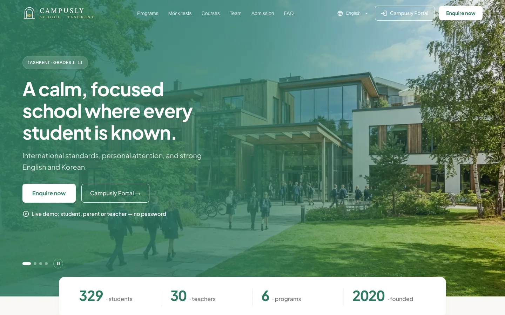
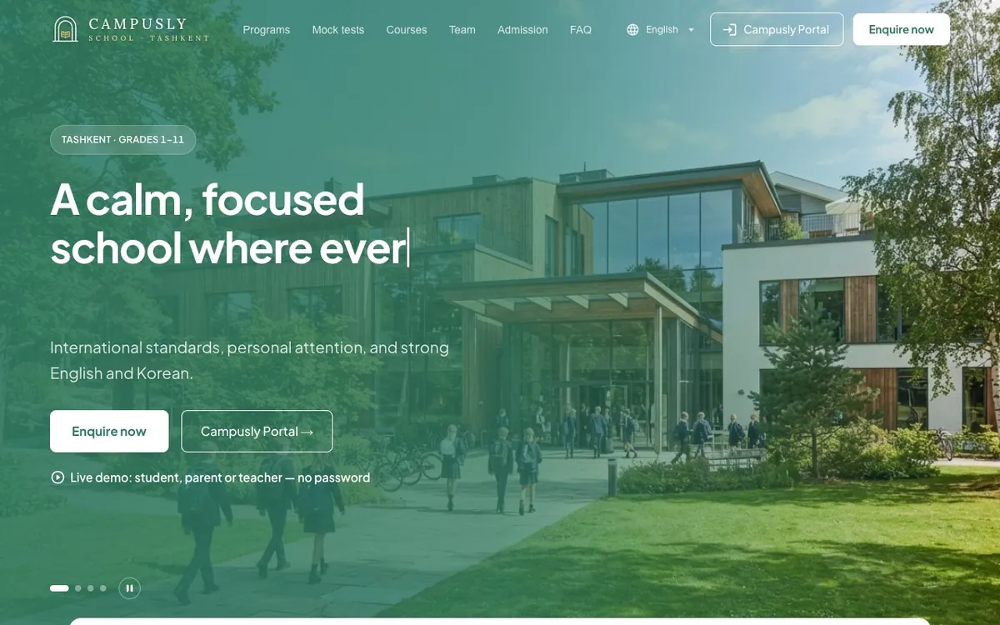
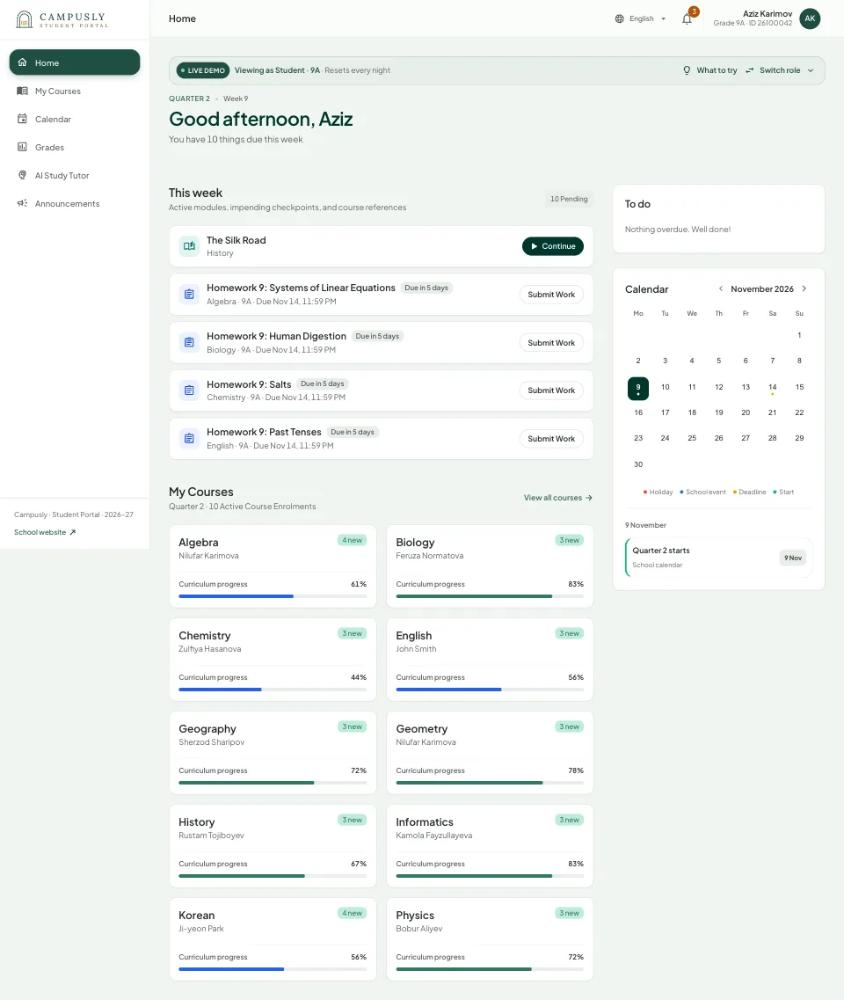
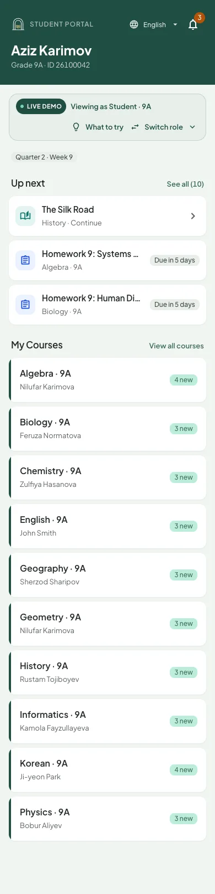
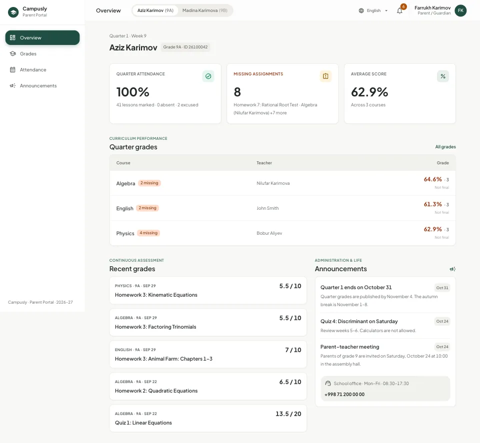
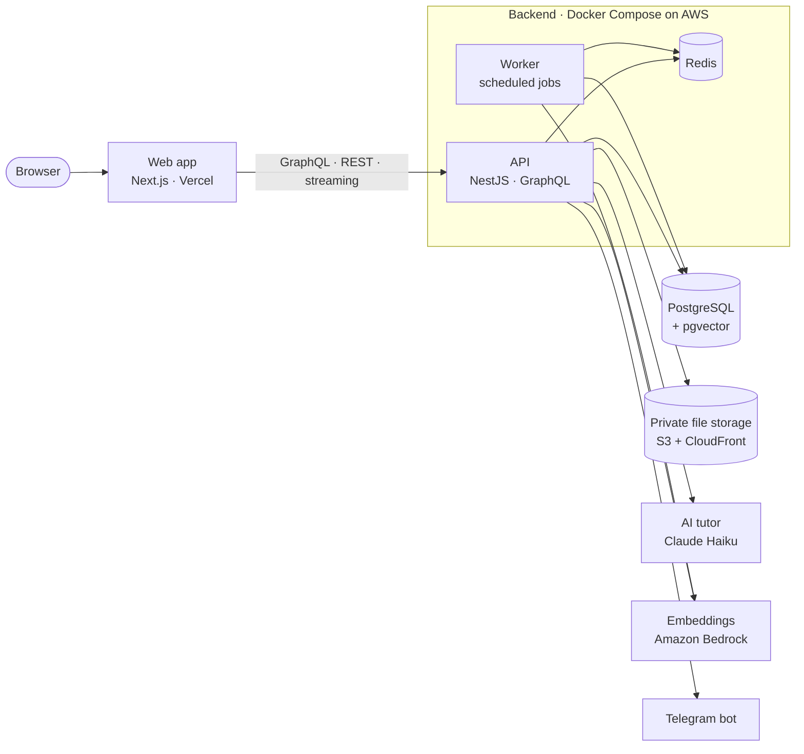

# Campusly

[](https://github.com/sanjardevx/campusly/actions/workflows/ci.yml)
[](LICENSE)
[](https://campusly.uz)

**A learning platform for a private K-12 school** — one portal for students, teachers and parents, a public school website the school edits itself, and an AI study tutor that helps students with hints from their own course material.

> 🇰🇷 **한국어 요약** — 사립 K-12 학교를 위한 학습 관리 플랫폼(LMS)입니다. 학생·교사·학부모 포털, 학교가 직접 편집하는 공개 웹사이트, 그리고 수업 자료를 근거로 힌트를 주는 AI 튜터(RAG)를 제공합니다. NestJS · GraphQL · PostgreSQL(pgvector) · Next.js로 개발했고, 440개의 자동 테스트를 통과하면 AWS와 Vercel에 자동 배포됩니다.



## Try it

Open **[campusly.uz](https://campusly.uz)** → **Campusly Portal** → **Live demo**. One click, no password: look around as a student (grade 9 or 11), a parent or a teacher.

The demo is an invented school with real-looking data: classes, lessons, homework, grades and attendance follow the real school calendar, and everything is reset every night, so feel free to click, submit and grade.



*30 seconds of the live demo: a student opens this week's homework, gets a hint from the AI tutor, hands in a photo of the solution, and the teacher grades it.*

## What it does

**For students** — every course organised by school week: lessons with notes, PDFs and videos, homework with file upload, timed quizzes that grade themselves, grades and attendance per quarter, a calendar of what is due, school and course announcements, a place to ask the teacher questions, and an **AI Study Tutor** that gives step-by-step hints (never the final answer) from the course's own material.

**For teachers** — build each week's lessons, homework and quizzes; grade submissions with feedback; a gradebook with category weights and quarter grades; attendance; announcements; one inbox for students' questions.

**For parents** — each child's grades, attendance, calendar and announcements in one place, on a phone first. Parents see only published grades, and never a child's tutor conversations.

**For the school** — user and class management, school settings and calendar, an activity log, and a built-in editor for the public website: news and events, programs and clubs, the team, mock tests, free open courses, honor students and admission enquiries.

Available in **English, Uzbek, Russian and Korean**, with a Telegram bot for linking an account and resetting a password.

| Student portal | On a phone | Parent portal |
|---|---|---|
|  |  |  |

## Architecture



- **Two backend programs, one codebase:** the API answers the web app; the worker runs scheduled jobs (nightly demo reset, indexing course material for the tutor, closing timed-out quizzes, marking abandoned uploads as failed). Both share one database schema.
- **Web app:** server-rendered public website (rebuilt from the CMS every few minutes) and a client-side portal that talks to the API over GraphQL.
- **Delivery:** every push runs type checks, linting and the full test suite against a real database; when it passes, the backend deploys itself to AWS and the web app to Vercel.

## Tech stack

| Layer | Tools |
|---|---|
| Frontend | Next.js 16, React 19, TypeScript, MUI 9, Apollo Client 4, GraphQL Codegen, next-i18next |
| Backend | NestJS 11, GraphQL (Apollo Server, code-first), Prisma 7, PostgreSQL 17 + pgvector, Redis 7, NestJS Schedule (cron) |
| AI | Claude Haiku 5.5 (Anthropic API), Amazon Titan Text Embeddings V2 (Bedrock), retrieval with pgvector |
| Cloud & DevOps | AWS (EC2, RDS, S3, CloudFront, Bedrock), Docker Compose, Caddy, Vercel, GitHub Actions |
| Testing | Jest — 75 unit tests and 365 end-to-end tests, including access-isolation tests for every API operation; a Playwright smoke test of the live demo |

## Engineering highlights

- **Secure by default.** Every API operation requires a signed-in user with the right role unless it is explicitly public, and every record is checked for ownership in one place: a student only ever reaches their own courses, a parent only their own children. Automated tests try every operation as the "wrong" user.
- **Careful sign-in.** Short-lived access tokens kept in memory, refresh tokens in an httpOnly cookie that rotates on every use and detects reuse of a stolen token.
- **Records are never lost.** Nothing is hard-deleted (archive + activity log), grades stay hidden from students and parents until the teacher publishes them, and quarter grades are a published snapshot computed by small, unit-tested functions.
- **An AI tutor that teaches.** Course material is split into pieces and indexed with embeddings; a student's question finds the closest material *of that course they are allowed to see*, and the model streams a short hint at one of four help levels. Daily limits and a school-wide budget keep costs predictable, and no names are sent to the model.
- **A demo that stays true.** The demo school is generated on the real calendar (one quarter finished and graded, the next one running) and rebuilt every night, so the live demo always looks like a school in the middle of its year.

## Run it locally

Needs Node 24, pnpm (`corepack enable`) and Docker.

```bash
docker compose up -d                 # PostgreSQL + Redis

cd backend
cp .env.example .env                 # fill in your own local values
pnpm install
pnpm prisma migrate dev              # create the tables
pnpm prisma db seed                  # generate the demo school (wipes the local database)
pnpm dev                             # API on http://localhost:3000/graphql

cd ../frontend
cp .env.example .env.local
pnpm install
pnpm dev                             # web app on http://localhost:3001
```

Backend tests: `pnpm test` (unit) and `pnpm test:e2e` (needs the Docker database). Frontend: `SMOKE_URL=https://campusly.uz pnpm test:smoke` opens every live-demo role in Chrome. The AI tutor stays off locally unless a provider is configured; `TUTOR_PROVIDER=fake` gives canned answers without any API key.

## Project structure

```
backend/
  apps/campusly-api/      GraphQL + REST API (NestJS)
  apps/campusly-batch/    worker: scheduled jobs
  prisma/                 database schema, migrations, demo-school generator
frontend/
  pages/                  public website, sign-in, student / teacher / parent / admin portals
  libs/components/        UI by area
  public/locales/         en, uz, ru, ko
docs/                     product and architecture decisions, build plan
```

## What I'd do next

- **A parent mobile app** with push notifications for new grades, homework and announcements.
- **An evaluation set for the AI tutor**, run on every release, to track hint quality, cost and response time.
- **More than one school** on the same platform, each with its own data, website and settings.

## License

The code is released under the [MIT License](LICENSE). Photos and school content on the demo website are for demonstration only and are not covered by the license.
